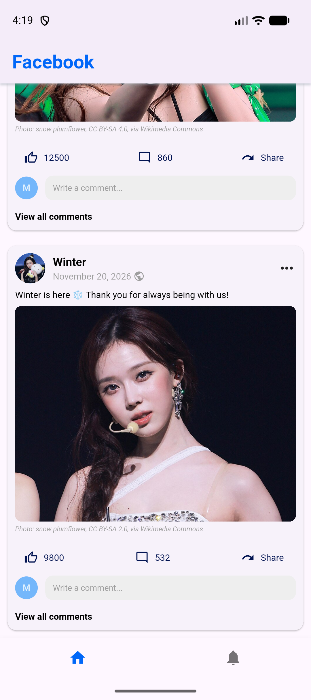
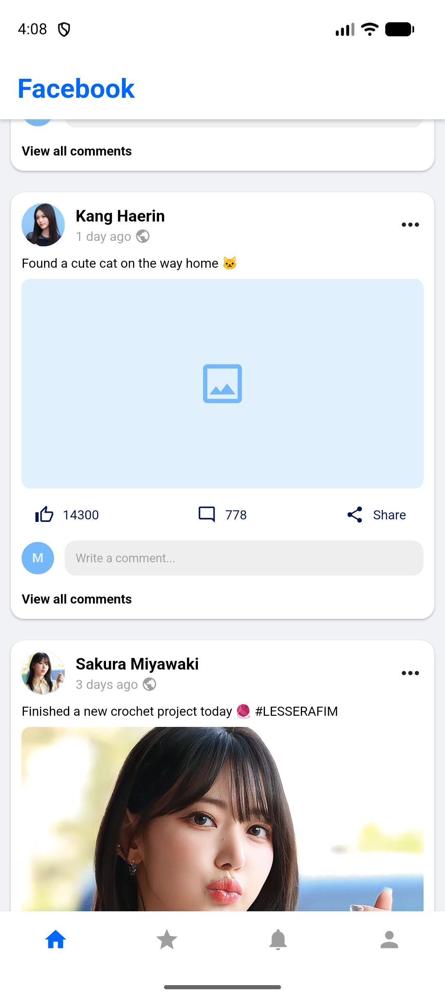
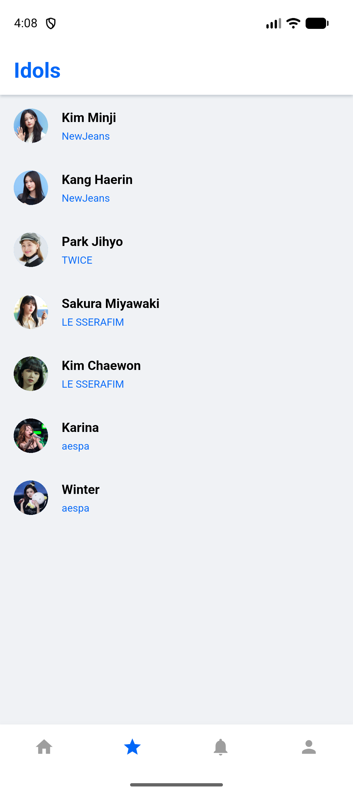
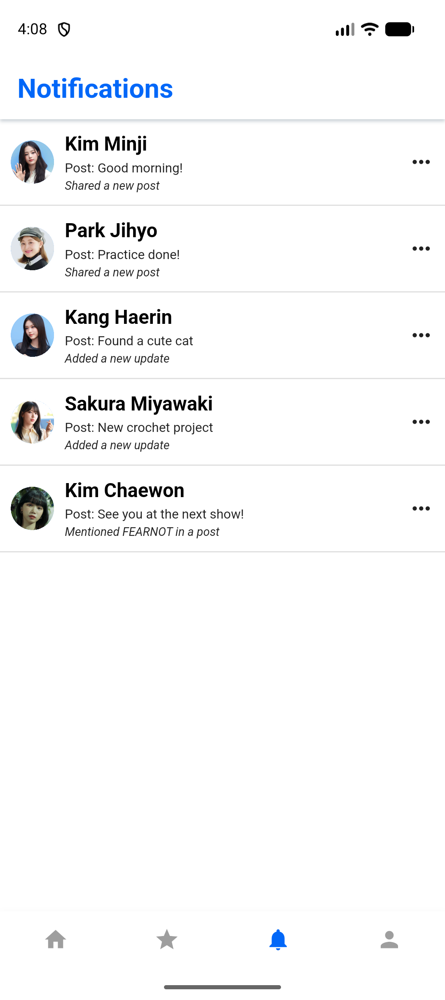
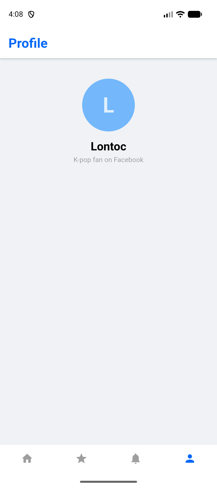

# Lontoc_mobprog

A Facebook-style app of K-pop idols, built with Flutter for Mobile Programming. The posts and notifications are made-up sample data for a class activity.

Repository: <https://github.com/banana-juice/Lontoc_mobprog>

- [Laboratory Activity 2A: List Widgets](#laboratory-activity-2a-list-widgets)
- [Laboratory Activity 1A: File Structuring | Design Pattern](#laboratory-activity-1a-file-structuring--design-pattern)
- [Photo credits](#photo-credits)

## Laboratory Activity 2A: List Widgets

### File structure

```text
lib/
├── screens/
│   ├── home_screen.dart
│   ├── newsfeed_screen.dart
│   ├── notification_screen.dart
│   ├── idols_screen.dart
│   └── profile_screen.dart
├── widgets/
│   ├── custom_text.dart
│   ├── newsfeed_card.dart
│   ├── notification.dart
│   ├── post_action_button.dart
│   ├── post_image.dart
│   └── user_avatar.dart
├── constants.dart
└── main.dart
```

### Screenshots

#### Before enhancement

| Newsfeed | Newsfeed, scrolled |
| --- | --- |
|  |  |

#### After enhancement

| Photo post | Like count updated | Placeholder post | Text-only post |
| --- | --- | --- | --- |
|  |  |  |  |

| Idols | Notifications | Profile |
| --- | --- | --- |
|  |  |  |

### Laboratory Discussion

**Question:** Discuss how you manage to do the posts and the notifications efficiently. Also, discuss how you accomplished the enhancements, state the challenges, and how you addressed them.

#### Managing the posts and notifications efficiently

1. **One reusable widget for each kind of item.** `NewsfeedCard` draws every post and `NotificationCard` draws every notification. A design change is made in one file and applies to all items. Smaller parts (`UserAvatar`, `PostImage`, `PostActionButton`, `CustomText`) are reused as well.
2. **Data is kept in lists.** Each screen holds a list of items, so adding a post or notification only needs one new entry. The post list is created once (`late final`), and the notification list is `static const`.
3. **`ListView.builder` builds items on demand.** Flutter builds the rows that are on or near the screen instead of laying out the whole list at once, so scrolling stays light as the list grows.

```dart
return ListView.builder(
  itemCount: _posts.length,
  itemBuilder: (context, index) => _posts[index],
);
```

4. **State is kept only where it is needed.** `AutomaticKeepAliveClientMixin` keeps the newsfeed's scroll position when switching tabs, and a post's like button is kept alive only while it is liked.

#### How I accomplished the enhancements

| Enhancement | How it was done |
| --- | --- |
| 1. Dynamic post | `NewsfeedCard` takes the like count, comment count and a `DateTime`. `formatDate` shows "25 minutes ago" for recent posts and a full date after a week. A post shows a photo (`imagePath`), a placeholder (`hasPlaceholder`) or no image. |
| 2. Dynamic AppBar title | `HomeScreen` keeps a list of titles in the same order as the pages and shows `_titles[_selectedIndex]`. |
| 3. More `BottomNavigationBarItem`s | Added Idols and Profile, for four items: Home, Idols, Notifications and Profile. |
| 4. App name | The app was renamed Kpopverse during development, then returned to Facebook. The final version keeps the name Facebook. |
| 5. Color palette | A violet palette was tried, then replaced with the Facebook scheme: blue, white and light grey, defined in `constants.dart`. |

#### Challenges and how I addressed them

| Challenge | Solution |
| --- | --- |
| A date stored as text could not change as the post got older. | Stored it as a `DateTime` and formatted it when the card is built. |
| Not every post has a photo. | Used a collection `if` / `else if` to choose between the photo, the placeholder and nothing. |
| A lazy list can discard a post's state when it scrolls out of view. | Used keep-alive mixins so likes are not reset. |
| With more than three items, `BottomNavigationBar` changes to its shifting style. | Set `type: BottomNavigationBarType.fixed`. |
| Flutter already has a class named `Notification`. | Named the widget class `NotificationCard` and kept the file name `notification.dart`. |
| Material 3 tinted the white AppBar. | Set `surfaceTintColor: Colors.transparent`. |
| Photos need permission to be reused. | Used Creative Commons photos from Wikimedia Commons and listed their credits. |
| Tall portrait photos could be cropped away from the face. | Aligned the crop of avatars and post images toward the top. |

## Laboratory Activity 1A: File Structuring | Design Pattern

### Laboratory Discussion

**Question:** Discuss how you integrate the image to the `newsfeed_card.dart` and make it dynamic whether it has an image or not.

#### 1. The image is an optional parameter

In `lib/widgets/newsfeed_card.dart`, the card takes the image as a nullable `String?`:

```dart
final String? imagePath;
final String? photoCredit;

const NewsfeedCard({
  ...
  this.imagePath,
  this.photoCredit,
});
```

Since `imagePath` is not `required`, a post can be created with or without a picture. A text-only post just leaves it out, and the default value is `null`.

#### 2. Collection `if` decides whether the image is shown

Inside the card's `Column`, the image is placed with Dart's collection `if`:

```dart
if (imagePath != null) PostImage(imagePath: imagePath!),
if (imagePath != null && photoCredit != null)
  Padding(
    ...
    child: CustomText(text: photoCredit!, ...),
  ),
```

- If `imagePath` is `null`, the `PostImage` widget is **not added to the widget tree at all**. No empty space or blank box is left, so the like/comment row moves up right under the post text.
- If `imagePath` is `null` but `hasPlaceholder` is `true`, a `PostPlaceholder` box is shown instead.
- If `imagePath` has a value, `PostImage` is added between the post content and the action buttons.
- The photo credit follows the same idea. It only appears when there is an image **and** a credit, so a credit can never show under a post with no picture.

#### 3. `PostImage` is a separate reusable widget

The image logic lives in `lib/widgets/post_image.dart` so that `NewsfeedCard` stays short and readable. `PostImage`:

- Accepts either a **network URL** (starts with `http`, uses `NetworkImage`) or a **local asset path** (uses `AssetImage`), so the same card works for both.
- Shows a `CircularProgressIndicator` while the image loads (`loadingBuilder`).
- Shows a grey broken-image placeholder if the image cannot be loaded (`errorBuilder`), so a bad path does not crash the screen.
- Uses `BoxFit.cover` with rounded corners (`ClipRRect`) and a responsive height from `flutter_screenutil`.

#### 4. The avatar also handles a missing image

`lib/widgets/user_avatar.dart` uses the same approach for the profile picture. `avatarPath` is nullable, and if it is `null` or fails to load, the avatar falls back to the user's initials (for example "K" for Karina) inside the `CircleAvatar`.

#### 5. Usage in `newsfeed_screen.dart`

```dart
// Post WITH an image
NewsfeedCard(
  userName: 'Winter',
  postContent: 'Winter is here ❄️ Thank you for always being with us!',
  date: DateTime(2026, 11, 15),
  avatarPath: 'assets/images/winter.jpg',
  imagePath: 'assets/images/winter_post.jpg',
  photoCredit: 'Photo: snow plumflower, CC BY-SA 2.0, via Wikimedia Commons',
),

// Post WITHOUT an image (just omit imagePath)
NewsfeedCard(
  userName: 'Karina',
  postContent: 'Ready for the stage tonight! 💙',
  date: DateTime(2026, 11, 27, 9),
),
```

#### 6. Asset setup

The local images are stored in `assets/images/` and registered in `pubspec.yaml`:

```yaml
flutter:
  assets:
    - assets/images/
```

After adding new asset files, the app has to be fully stopped and run again (`flutter run`). Hot reload and hot restart do not bundle new assets, so the images show the broken-image placeholder until the app is rebuilt.

#### Summary

| Case | `imagePath` | Result |
| --- | --- | --- |
| Text-only post | `null` | No image area is built, and the layout closes up. |
| Photo not available yet | `null`, `hasPlaceholder: true` | A placeholder box is shown. |
| Post with an image | a path or URL | `PostImage` is shown, with a loader while loading. |
| Image fails to load | invalid path or URL | A grey placeholder icon is shown instead of an error. |
| Image with a credit | path and `photoCredit` | The credit text is shown under the image. |

Making `imagePath` nullable and checking it with a collection `if` keeps one `NewsfeedCard` widget flexible for every kind of post, without duplicating the card for "with image" and "without image" versions.

## Photo credits

Photos from Wikimedia Commons, some resized and cropped in the app.

| File | Author | License | Link |
| --- | --- | --- | --- |
| `minji.jpg` | K-POPIT | [CC BY 3.0](https://creativecommons.org/licenses/by/3.0/) | [Source](<https://commons.wikimedia.org/wiki/File:20230905_Minji_(NewJeans).jpg>) |
| `haerin.jpg` | K-POPIT | [CC BY 3.0](https://creativecommons.org/licenses/by/3.0/) | [Source](<https://commons.wikimedia.org/wiki/File:20230905_Haerin_(NewJeans).jpg>) |
| `jihyo.jpg` | Pearly Gates Korea | [CC BY 3.0](https://creativecommons.org/licenses/by/3.0/) | [Source](<https://commons.wikimedia.org/wiki/File:Park_Jihyo_for_Pearly_Gates_Korea_01.jpg>) |
| `sakura.jpg` | K-POPIT | [CC BY 3.0](https://creativecommons.org/licenses/by/3.0/) | [Source](<https://commons.wikimedia.org/wiki/File:20230630_Sakura_(LE_SSERAFIM).jpg>) |
| `chaewon.jpg` | MUSHROOM COMPANY | [CC BY 3.0](https://creativecommons.org/licenses/by/3.0/) | [Source](<https://commons.wikimedia.org/wiki/File:Kim_Chaewon_LE_SSERAFIM_220923.jpg>) |

Credits for the Karina and Winter photos appear under their posts.
